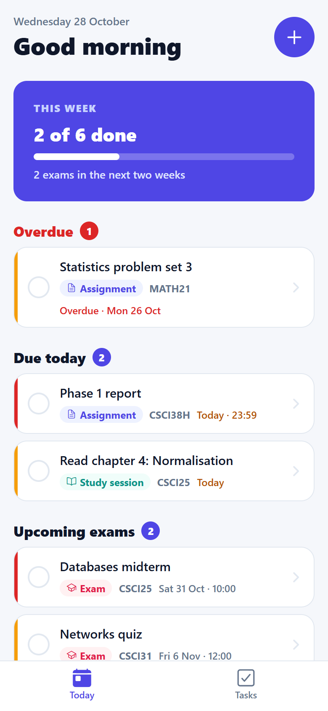
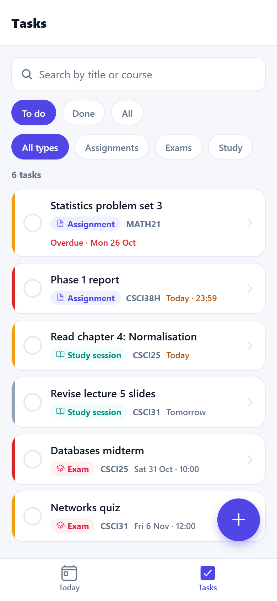
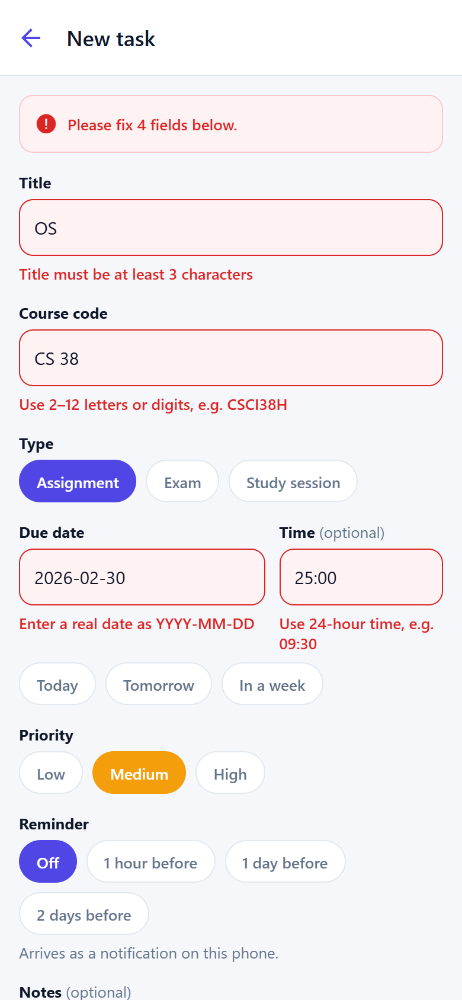

# StudyPulse

A study planner and deadline reminder app for university students, built with React Native, Expo Router and TypeScript.
Course project for Mobile Application Development (26CSCI38H).

Students record each assignment, exam and study session once. The app opens on a **Today** dashboard showing what is overdue, what is due today and which exams are coming up, plus progress for the week.

## Phase 1 (this version)

- **Today dashboard:** weekly progress, overdue tasks, tasks due today, exams in the next 14 days.
- **Task list:** sorted by due date, search by title or course code, filter by status and type.
- **Add / edit / delete tasks:** every field is validated with a message under the field; delete asks for confirmation.
- **Saved on the phone:** tasks are stored with AsyncStorage and survive restarts. First launch adds 8 sample tasks.

Coming in Phase 2: reminder notifications (`expo-notifications`, the device feature), Google Calendar export (the Google API), and three unit tests.

| Today | Tasks | New task (validation) |
| --- | --- | --- |
|  |  |  |

## Run it

```bash
npm install
```

```bash
npx expo start
```

Scan the QR code with Expo Go (phone and laptop on the same Wi-Fi), press `a` for an Android emulator, or `w` to open it in the browser. If the phone can't connect, use `npx expo start --tunnel`.

Checks:

```bash
npx tsc --noEmit
```

```bash
npx eslint src
```

## Project structure

```
src/
├─ app/                      routes only (Expo Router)
│  ├─ _layout.tsx            root Stack, wraps the app in TasksProvider
│  ├─ (tabs)/_layout.tsx     bottom tabs: Today, Tasks
│  ├─ (tabs)/index.tsx       → DashboardScreen
│  ├─ (tabs)/tasks.tsx       → TaskListScreen
│  └─ task/form.tsx          → TaskFormScreen (new, or edit with ?id=)
├─ features/tasks/           everything for the tasks feature
│  ├─ screens/               DashboardScreen, TaskListScreen, TaskFormScreen
│  ├─ components/            TaskCard, TaskSection, WeekProgressCard
│  ├─ hooks/                 useTasks, useTaskForm
│  ├─ providers/             TasksProvider (React Context)
│  ├─ services/              taskRepository (load / save)
│  ├─ validation.ts          validateTask(): all form rules, pure function
│  ├─ logic.ts               sortTasks, filterTasks, buildDashboard, dueLabel
│  └─ types.ts · dates.ts · meta.ts · sampleData.ts · index.ts
├─ components/ui/            AppButton, Chip, ChoiceField, FormField, EmptyState, ErrorBanner, LoadingView
├─ navigation/routes.ts      every link in one place
├─ services/storage.ts       AsyncStorage JSON helpers
└─ theme/tokens.ts           colours, spacing, radius, font sizes
```

## Architecture decisions

- **Provider pattern with feature-first folders.** `TasksProvider` owns the task list and exposes it through `useTasks()`, so the dashboard, the list and the form share one source of truth without prop drilling. All task code lives in `src/features/tasks`; shared code never imports a feature.
- **Thin routes.** Files in `src/app` only render a screen. Screens only render; state lives in the provider; rules (`validation.ts`, `logic.ts`) are pure functions that are easy to unit test.
- **Repository for storage.** `taskRepository` is the only code that knows tasks are in AsyncStorage (key `studypulse/tasks/v1`), so Phase 2 can add sync or notifications without touching the screens.
- **Navigation.** A root Stack holds the bottom tabs (Today, Tasks) and pushes the task form on top, with the task id as a route parameter for editing.
- **Styling.** `StyleSheet` with shared design tokens in `src/theme/tokens.ts` (colours, spacing, radius, font sizes), so every screen uses the same scale.

## Docs

- `docs/StudyPulse-Phase1-Report.docx`: the Phase 1 report.
- `docs/diagrams/`: use case, activity, data model and architecture diagrams (SVG sources and PNGs; `make_diagrams.py` regenerates the SVGs).
- `docs/screenshots/`: the screens used in the report.
- `docs/ai-log.md`: the AI engineering log.

## Environment variables

Copy `.env.example` to `.env` for Phase 2 (Google client IDs). `.env` is ignored by Git; never commit real values.
